<p align="center">
  
</p>

<p align="center">
  
  
  
  <a href="https://www.linkedin.com/in/torjoc-cynthia-giorgiana-6a692942a/"></a>
</p>

```text
❯ cat about.txt
  hi, I'm Cynthia — the girl in the room who reads the data and picks the font.
  not a programmer (yet). I build anyway, with Claude Code & Cursor.

❯ ls ./now
  datasap/      → AI call-center robots: market research, pre-sale mockups, case studies
  master/       → master's student @ SNSPA · FCRP, year I
  side-quests/  → teaching myself git, HTML and how to boss AI agents around
```

### 🎀 what lives here

| | |
|---|---|
| **research** | market studies & company briefs, sourced and checked — no made-up numbers |
| **mockups** | single-file HTML prototypes for pitches, in the client's brand |
| **AI workflows** | skills & prompts that turn repetitive work into one-liners |

### 🌷 featured work

| | |
|---|---|
| **[petala-mockup-demo](https://github.com/cynthiatorjoc10/petala-mockup-demo)** | a pre-sale landing page for a fictional Bucharest florist · [see it live →](https://cynthiatorjoc10.github.io/petala-mockup-demo/) |
| **[claude-code-skills](https://github.com/cynthiatorjoc10/claude-code-skills)** | my Claude Code skills for market research, mockups, storyboards and content |

### 💅 toolkit

<p>
  
  
  
  
  
</p>

<p align="center"><sub><code>// pink is a perfectly valid hex code: #ff5fa8</code></sub></p>
